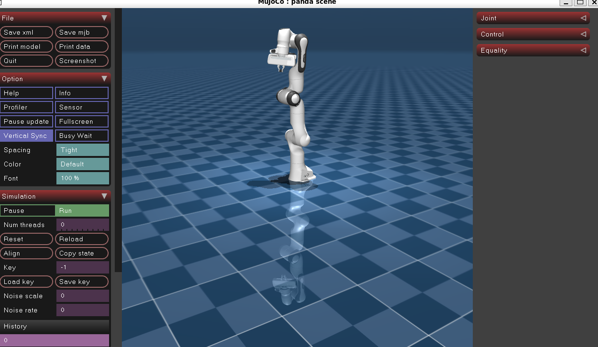

# Demo 01: MuJoCo 加载 Franka Panda

用 MuJoCo 加载 Franka Emika Panda 7 轴机械臂，验证仿真环境可用。

## 依赖
- mujoco 3.x
- mujoco_menagerie（sparse checkout 只拉了 panda）

## 运行
python demo-01-mujoco-panda/view_panda.py

## 结果

- nq = 9（7 个关节 + 2 个夹爪）
- nu = 8

## 备注
模型路径写死在脚本里的 `/home/cui/projects/mujoco_menagerie/franka_emika_panda/scene.xml`，
换机器需要改。